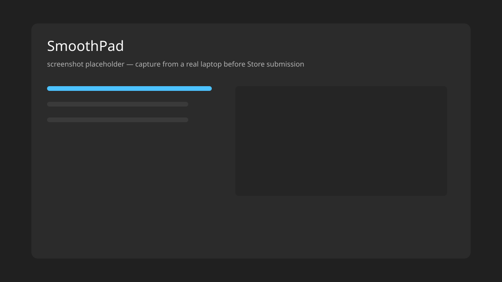

# SmoothPad

Open-source Windows 11 utility that gives Precision Touchpads **macOS-inspired pointer motion** — precise at low speed, velocity-aware on fast swipes — without pointer inertia, without touching external mice, and without claiming to be Apple’s algorithm.

**Status: 0.1.0 — user-mode engine is real. Production Mac Mode is not.** This tree does **not** ship a Microsoft-signed kernel driver. Without that driver, SmoothPad stays in **Windows Native / Degraded** so native + injected movement cannot stack.

If you have the [Windows Driver Kit](https://learn.microsoft.com/windows-hardware/drivers/download-the-wdk) and (for other people’s PCs) a Hardware Dev Center signature, you can build and supply `SmoothPadFilter.sys` yourself. See [docs/byo-driver.md](docs/byo-driver.md). Do **not** disable Secure Boot or Driver Signature Enforcement to run it.



## What this repo is

| Piece | In this tree | Ready for daily use |
| --- | --- | --- |
| Motion engine (C++23) | Yes | Yes (library + tests) |
| PTP Raw Input + HID parse | Yes | Yes (`inspect` / traces) |
| Tray app, profiles, hotkeys | Yes (Win32) | Partial — Native path only |
| Synthetic `PT_TOUCHPAD` output | Runtime-detected | Harmless until native promotion is muted |
| KMDF HID upper filter **source** | Yes (pass-through + watchdog) | **No binary, no Microsoft signature** |
| Mac Mode (replace the cursor) | Gated off | **No** until a signed filter actually suppresses native reports |

This is intentional. User-mode APIs can observe or inject; they cannot mute the physical pad. Advertising Mac Mode without a filter would double-move the cursor.

## Supported

| | |
| --- | --- |
| OS | Windows 11 24H2 or newer (runtime feature detection; no crash on missing APIs) |
| Hardware | Windows **Precision** Touchpad (HID Digitizer `0x0D` / Touch Pad `0x05`), typically the built-in laptop pad (I2C; USB/BT also enumerated) |
| Not supported | Legacy “mouse” touchpads, gaming mice, injecting into other processes |

## Quick start (no driver)

Needs Visual Studio 2022/2026 with the C++ desktop workload and Windows SDK **10.0.26100+**. WDK is **not** required.

```powershell
git clone https://github.com/Shiroo09/SmoothPad.git
cd SmoothPad
.\scripts\build.ps1 -Configuration Release -Platform x64
.\scripts\test.ps1
.\out\x64\Release\SmoothPad.App.exe
```

CLI:

```text
.\out\x64\Release\SmoothPad.Cli.exe inspect
.\out\x64\Release\SmoothPad.Cli.exe bench
.\out\x64\Release\SmoothPad.Cli.exe curve
```

You will get diagnostics, settings, traces, and **Windows Native** motion. Mac Mode will show **Degraded**. That is correct.

## Mac Mode (only with your driver)

Tray: **Mac-like Touchpad**. Profiles: Mac Balanced (default) · Mac Smooth · Mac Fast · Windows Native (real bypass).

Mac Mode is **not advertised** unless:

1. `SmoothPadFilter` is loaded, in Custom, and heartbeating, **and**
2. `CreateSyntheticPointerDevice2(PT_TOUCHPAD)` exists at runtime.

Otherwise the UI stays **Degraded** / **Windows Native**.

Emergency native: `Ctrl+Alt+Shift+M`. Toggle: `Ctrl+Alt+M` (fails gracefully on conflict).

**Bring-your-own driver:** source, INF, and IOCTL protocol are in [`src/SmoothPad.Filter`](src/SmoothPad.Filter). Building `.sys`, signing, and installing is **your** hardware/legal surface. This project will not tell users to turn off Secure Boot.

- How: [docs/byo-driver.md](docs/byo-driver.md)
- Why a filter: [docs/architecture.md](docs/architecture.md) · [docs/research.md](docs/research.md)
- Signing reality (2026): [docs/driver-signing.md](docs/driver-signing.md)

Custom suppression (driver implementation **step 6**) is **not armed**. The skeleton is pass-through. Completing that step is a filter-contributor job, on a VM, with a recovery plan.

## Profiles and calibration

Custom profiles: JSON import/export under `%AppData%\SmoothPad\profiles`. Built-ins are read-only.

**Calibrate** is a wizard shell (still / slow / normal / swipe / full-surface). Skip is allowed; conservative defaults apply if you do not record a live trace.

## Diagnostics

The main window reports PTP presence, VID/PID, transport, physical size, report rate, engine latency (process path only — not display latency), input/output backend, and driver state.

```text
SmoothPad.Cli.exe inspect
SmoothPad.Cli.exe record capture.sptrace 15
SmoothPad.Cli.exe replay capture.sptrace
```

## Build

| Target | Command | Needs WDK |
| --- | --- | --- |
| App, CLI, tests | `.\scripts\build.ps1` | No |
| Tests + benches | `.\scripts\test.ps1` | No |
| Filter `.sys` | `.\scripts\build-filter.ps1` | **Yes** |
| Unsigned MSIX stage | `.\scripts\package.ps1 -Version 0.1.0` | No |

`SmoothPad.sln` does **not** include the KMDF project, so a machine without the WDK still compiles the product.

See [CONTRIBUTING.md](CONTRIBUTING.md).

## Security and privacy

No telemetry, no cloud, no accounts. Traces stay local and opt-in.

- [docs/privacy.md](docs/privacy.md)
- [SECURITY.md](SECURITY.md)

Kernel work is optional and fail-open (250 ms watchdog → pass-through). Do not install an unsigned or test-signed filter on a Secure Boot daily driver.

## Uninstall

Close SmoothPad. If **you** installed a filter, run `scripts/uninstall-filter.ps1` elevated **before** deleting files. Native touchpad must keep working. Safe Mode is the recovery path.

## Docs

| Doc | Topic |
| --- | --- |
| [docs/README.md](docs/README.md) | Index |
| [docs/architecture.md](docs/architecture.md) | Stack and why a filter exists |
| [docs/byo-driver.md](docs/byo-driver.md) | Build / sign / install the filter yourself |
| [docs/tuning.md](docs/tuning.md) | Curve intent (not “copy Apple numbers”) |
| [docs/troubleshooting.md](docs/troubleshooting.md) | Degraded, double-move, gestures |
| [docs/hardware-validation.md](docs/hardware-validation.md) | What still needs a real laptop |

## License

[MIT](LICENSE). Third-party references (studied, not copied): [THIRD_PARTY_NOTICES.md](THIRD_PARTY_NOTICES.md).

SmoothPad is not affiliated with Apple. It does not use Apple code or claim bit-exact MacBook emulation.
