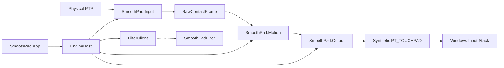

# Architecture

SmoothPad is a Windows 11 utility that replaces Precision Touchpad **single-finger pointer mapping** with a velocity-aware, macOS-inspired curve while preserving Windows gestures and leaving external mice untouched.

## WHY A DRIVER IS REQUIRED

Documented user-mode APIs (Raw Input, SPI touchpad parameters, synthetic `PT_TOUCHPAD`, touchpad-capable window registration) **observe or inject**. They do not replace the physical device in the HID → class → Win32 pointer path.

If SmoothPad injects motion while the physical PTP still promotes contacts to the cursor, the user gets **native + custom** movement. That violates a hard acceptance criterion.

Therefore Mac Mode’s production path is:

```
Physical PTP HID collection (0x0D / 0x05)
        │
        ▼
SmoothPadFilter.sys   (KMDF upper filter of THAT collection only)
        │
        ├── Custom + fresh heartbeat  → hold native reports, copy to user mode
        └── otherwise                 → PASS-THROUGH (fail-open)
        │
        ▼
SmoothPad.exe  (Raw Input still used as the primary contact source;
                filter is the suppression gate, not the motion brain)
        │
        ▼
CreateSyntheticPointerDevice2(PT_TOUCHPAD, SDCO_PHYSICAL_SIZE)
        │
        ▼
Windows pointer / gesture pipeline
```

Until **you** install a built-and-signed filter **and** `CreateSyntheticPointerDevice2` exists at runtime, the UI stays in **Degraded** / **Native**. It will not claim Mac Mode. This GitHub tree ships filter **source**, not a Microsoft-signed `.sys`.

The driver does **not** implement acceleration, smoothing, or profiles. Bring-your-own instructions: [byo-driver.md](byo-driver.md).

## Components



| Module | Responsibility | Windows knowledge |
| --- | --- | --- |
| `SmoothPad.Motion` | Normalize, track contacts, noise, velocity, gain curve, smoother, fractional pixels | None |
| `SmoothPad.Input` | Enumerate PTP, Raw Input, HidP parse | Win32 / HID |
| `SmoothPad.Output` | `IPointerOutput`: synthetic pad, diagnostic SendInput | Win32 |
| `SmoothPad.Platform` | QPC, SPI, hotkeys, Run key | Win32 |
| `SmoothPad.DriverClient` | IOCTL heartbeat / mode | Win32 |
| `SmoothPad.App` | Tray, settings, curve graph | Win32 (WinUI 3 packaged UI is the Store-facing successor; this tree ships a native Win32 GUI so the product builds with the installed SDK) |
| `SmoothPad.Filter` | Pass-through HID upper filter + watchdog | KMDF / WDK |

## Data flow

`RawContactFrame` is the IPC-sized snapshot: QPC, scan time, contact count, per-contact id/tip/confidence/X/Y, button. Motion consumes frames and emits `MotionOutput` (mm delta, pixel delta with remainder, gain, speed, state).

Velocity is mm/s from HID physical units when present, else from a documented 105×70 mm fallback (diagnostics show “fallback”).

## Thread model

- UI thread: Win32 message pump, tray, settings.
- Hidden message-only HWND: `WM_INPUT` + hotkeys. No disk I/O on this path except opt-in tracing (preallocated vector, flushed on stop).
- Filter heartbeat thread: 75 ms `DeviceIoControl`, only when the filter is connected.
- Motion `Process` is synchronous on the input callback; it allocates nothing on the hot path beyond stack.

No `THREAD_PRIORITY_TIME_CRITICAL`.

## Device detection

1. `GetRawInputDeviceList` → HID devices with usage 0x0D/0x05.
2. Rank I2C above USB above Bluetooth for “built-in”.
3. Ignore 0x01/0x02 mice entirely.
4. `SPI_GETTOUCHPADPARAMETERS` for `touchpadPresent` / `externalMousePresent`.

## Engine modes

`Unsupported` · `Native` · `Starting` · `MacMode` · `Bypass` · `Degraded` · `DriverDisconnected` · `Error`

Mac Mode is **actual** state: filter Custom + heartbeat + synthetic device. Anything less is Degraded/Native.

## Fail-open

Filter default `PASS-THROUGH`. Heartbeat every 75 ms. Watchdog 250 ms → Custom drops to pass-through. Crash, logout, sleep, uninstall: native pad remains.

## Packaging

- GitHub: `SmoothPad.App.exe` + `SmoothPad.Cli.exe` + hashes.
- Store (driverless experiment): MSIX (`packaging/msix`) if Mac Mode is ever possible without a kernel filter on a future OS.
- Store (driver path): Win32 listing + HTTPS offline installer with a WHCP-signed driver. See `docs/store/`. Same source tree.
